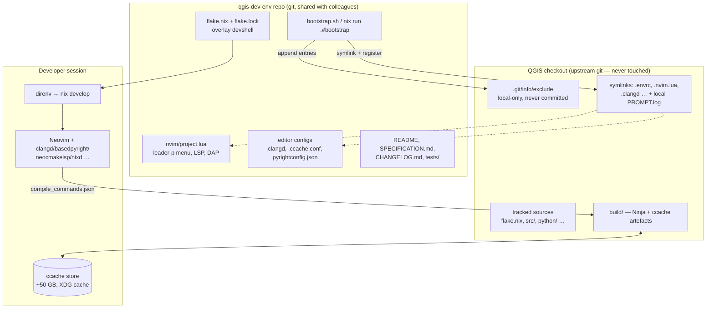

<!--
SPDX-FileCopyrightText: 2026 Kartoza (Pty) Ltd <tim@kartoza.com>
SPDX-License-Identifier: MIT
-->

# Software Requirements Specification

## QGIS Local Developer Environment Overlay (`qgis-dev-env`)

| | |
|---|---|
| **Document** | SRS-QGIS-DEV-ENV |
| **Version** | 1.0.0 |
| **Date** | 2026-07-09 |
| **Author** | Tim Sutton (tim@kartoza.com), Kartoza |
| **Status** | Draft — for review |
| **Licence** | MIT (tooling repo); QGIS itself remains GPL-2.0-or-later |
| **Audience** | Kartoza developers working on QGIS core using NixOS + Nix flakes + Neovim |

---

## 1. Introduction

### 1.1 Purpose

This document specifies a **reproducible, shareable, fully isolated developer
environment overlay** for hacking on QGIS core (C++20 / Qt6 / Python) on
NixOS. It defines everything needed to:

- compile QGIS **incrementally and fast** (ccache, Ninja, fast linker,
  targeted rebuilds) instead of paying a from-scratch compile per change;
- work entirely inside **Neovim** with first-class LSP support (C++, Qt6,
  Python/PyQGIS, CMake, Doxygen comments, Nix, Bash) and a discoverable
  `<leader>p` project menu covering every routine task;
- run **QGIS's own pre-commit hooks and coding-standards checks** from inside
  the editor, with failures landing in the Neovim quickfix list;
- guarantee that **none of this tooling can ever leak into an upstream QGIS
  commit or pull request** (upstream does not accept AI contributions), while
  the tooling itself **is** version-controlled and shareable with colleagues.

### 1.2 Scope

**In scope:** a standalone git repository (working name `qgis-dev-env`)
containing a Nix flake, Neovim project configuration, editor/LSP
configuration files, a bootstrap script, documentation, and tests. It is
overlaid onto any QGIS checkout via symlinks registered in
`.git/info/exclude`.

**Out of scope:** changes to QGIS source code, changes to QGIS's own tracked
`flake.nix` / `nix/` derivations (§2.4), packaging/release of QGIS itself,
CI for QGIS upstream, non-NixOS platforms (macOS/Windows may work but are
untested), and any workflow that produces commits intended for upstream QGIS
from AI-generated content.

### 1.3 Definitions

| Term | Meaning |
|---|---|
| **Overlay** | Files owned by `qgis-dev-env`, symlinked into the QGIS checkout, invisible to upstream git. |
| **Upstream** | `github.com/qgis/QGIS`. Tracked files in the checkout belong to upstream. |
| **Devshell** | The shell produced by `nix develop`, containing all build/edit/tooling dependencies. |
| **Overlay devshell** | The `qgis-dev-env` devshell = upstream QGIS devshell **plus** developer tooling. |
| **Quickfix** | Neovim's `:copen` list of file:line:message entries. |
| **PROMPT.log** | Local, git-excluded log of AI prompts kept per Kartoza policy. |

### 1.4 Reference documents

- Upstream `flake.nix` and `nix/{package,unwrapped,documentation}.nix` (tracked in QGIS master).
- Upstream `.pre-commit-config.yaml`, `.clang-format`, `.clang-tidy`, `.ruff.toml`, `.editorconfig`, `.git-blame-ignore-revs`.
- QGIS coding standards: https://docs.qgis.org/latest/en/docs/developers_guide/codingstandards.html
- Kartoza coding standards: https://kartoza.com/coding-standards
- QGIS `INSTALL.md` (build options reference).

### 1.5 Verified baseline (as of 2026-07-09)

| Fact | Value |
|---|---|
| Language standard | `CMAKE_CXX_STANDARD 20` (top-level `CMakeLists.txt`) |
| Qt | Qt 6 (`qt6Packages` throughout upstream flake) |
| Generator | Ninja, existing `build/` tree, `CMAKE_BUILD_TYPE=Debug` |
| Upstream flake | Exists and is **git-tracked**; devshell has no ccache, no clangd, no editor tooling |
| `compile_commands.json` | Not generated (`CMAKE_EXPORT_COMPILE_COMMANDS` unset) |
| ccache / clangd on PATH | Absent |
| `.envrc` / `.nvim.lua` / `.exrc` / `.clangd` | Absent |
| Pre-commit | Upstream config: local shell hooks (spell check, class names, banned keywords, doxygen test, SIP prep, shellcheck) + clang-format v21 + ruff |

---

## 2. Overall description

### 2.1 Product perspective



The product is a **sidecar repository, embedded in the checkout** as
`<QGIS>/qgis-dev-env/` — a plain nested git clone (not a submodule), hidden
from upstream git by the same local exclude mechanism as everything else.
Every developer-environment artefact lives in it and reaches the checkout
root only through **relative symlinks** that upstream git is told to ignore
locally. (An external location for the sidecar also works — bootstrap then
uses absolute links — but the embed is the canonical layout so the whole
project lives under one folder.)

### 2.2 User characteristics

Kartoza C++/Python developers on NixOS, fluent in Neovim, git, and Nix
flakes. No hand-holding UI required, but the `<leader>p` menu must be fully
discoverable (which-key labels) so a colleague can be productive in minutes.

### 2.3 Constraints

1. **C1 — Zero upstream leakage.** No overlay file may ever appear in
   `git status`, a commit, or a push of the QGIS repo. Mechanism must not
   modify any *tracked* upstream file (including `.gitignore`).
2. **C2 — Upstream flake is read-only.** The overlay extends the upstream
   devshell via Nix composition (`inputsFrom`), never by editing it.
3. **C3 — Nix-first dependency sourcing.** Every tool comes from nixpkgs;
   pip/npm only as documented last resort. `flake.lock` committed; lockfile
   updates in their own PR.
4. **C4 — Reproducibility.** Two colleagues with the same `qgis-dev-env`
   revision get byte-identical toolchains; `nix flake check` passes in CI.
5. **C5 — No code embedded in Nix files.** Neovim/lua, shell, and config
   artefacts are real dotfiles in the repo, deployed by reference — never
   heredocs inside `.nix`.
6. **C6 — No hard-coded nix-store paths committed.** Store paths are
   resolved at shell-hook time (e.g. exported as env vars), never baked into
   committed dotfiles.
7. **C7 — Kartoza standards apply to the overlay repo**: Conventional
   Commits, Keep-a-Changelog, REUSE/SPDX headers, gitleaks secret scanning,
   tests for every feature, docs current with code.
8. **C8 — i18n exception (explicit decision).** The overlay is internal
   developer tooling; UI strings are English-only. This deviation from the
   Kartoza i18n rule is accepted and recorded here.
9. **C9 — No telemetry.** All statistics (ccache, build times) are local
   files only.
10. **C10 — Build-tree strategy.** Development builds are ordinary
    CMake/Ninja builds **in the working tree** (`<checkout>/build/`), run
    directly from `build/output/bin/`. Nix provisions the *toolchain* only;
    QGIS is never compiled into the nix store as part of the development
    loop (upstream's `nix build` packaging remains available but is not our
    edit-compile-run path — a store build would forfeit incrementality).

### 2.4 Assumptions and dependencies

- The QGIS checkout is on a branch of upstream master with the tracked
  `flake.nix` present (verified).
- Nix ≥ 2.18 with flakes enabled; `direnv` + `nix-direnv` installed
  system-wide on each developer's NixOS machine.
- The developer's personal Neovim config enables `vim.o.exrc = true` (or
  loads `.nvim.lua` via a trust prompt) and provides plugin infrastructure
  (see FR-E1 for the graceful-degradation requirement).
- Disk: ≥ 100 GB free (build tree ≈ 30 GB Debug, ccache ≈ 50 GB).

### 2.5 The developer workflow, in plain language

This is the experience the requirements in §3 exist to deliver. Commands are
illustrative; the SRS-normative names are in FR-N4 and Appendix A.

**First-time setup (once per machine, ~10 minutes of typing, then coffee
while the cold build runs):**

1. **Check out upstream QGIS** somewhere you like:
   `git clone git@github.com:qgis/QGIS.git ~/dev/cpp/QGIS && cd ~/dev/cpp/QGIS`
2. **Check out the dev sidecar embedded inside it** — a plain nested clone,
   deliberately not a submodule:
   `git clone git@github.com:timlinux/qgis-dev-env.git qgis-dev-env`
3. **Prepare the QGIS checkout** — point the sidecar at its host:
   `./qgis-dev-env/bootstrap.sh .`
   This creates relative symlinks (`.envrc`, `.nvim.lua`, `.clangd`, …)
   reaching down into the embed, tells QGIS's *local* git to ignore them and
   the embed itself forever, and installs the pre-commit hooks and the
   anti-leak push guard.
4. **Enter the environment** — approve direnv:
   `direnv allow`
   Nix now drops you into a shell where every compiler, library, LSP server,
   and QA tool exists at pinned versions. Nothing was installed globally.
5. **Configure and do the one unavoidable cold compile:**
   `nix run .#configure && nix run .#build` (or open Neovim and hit
   `<leader>pc` then `<leader>pb`). Go for lunch — this is the last
   from-scratch compile you should ever need on this machine; ccache
   remembers everything from here on.

**The everyday loop (what you actually do all day):**

1. `cd ~/dev/cpp/QGIS && nvim src/core/whatever.cpp` — direnv activates the
   environment automatically; clangd, completion, and highlighting are live.
2. Edit. Navigate with go-to-definition into Qt6 headers, rename symbols,
   read Doxygen blocks fully highlighted.
3. `<leader>pb` — asynchronous rebuild of only what changed (seconds to a
   couple of minutes, not hours). If it fails, quickfix opens on the exact
   line; fix, repeat.
4. `<leader>pr` — run your freshly built QGIS against a throwaway profile
   and click around. `<leader>pt` runs the relevant tests.
5. `<leader>pp` — run QGIS's own pre-commit checks over your changed files;
   fix anything it lists in quickfix. Then commit as usual — the hooks run
   again as a safety net.

**Starting a second feature without disturbing the first:**

1. `<leader>pwn` (or `nix run .#worktree -- add my-feature`) — a new
   worktree appears as a sibling folder, already bootstrapped.
2. Build there: mostly ccache hits, so it's warm from the start. Switch
   between features with `<leader>pwl`; each keeps its own build tree and
   edit state. Remove it when merged with `<leader>pwD`.

**When something crashes, leaks, or is slow:**

`<leader>pas` for a sanitizer run (first resort for memory bugs),
`<leader>pam` for valgrind, `<leader>pah`/`<leader>pac` for heap/CPU
profiles, `<leader>pag` to introspect live Qt widgets. Findings land in
quickfix or open in the right visualizer, and every report is archived under
`.dev-env/diagnostics/` for attaching to bug reports.

**When something feels broken:** `<leader>pv` (doctor) tells you which of
the moving parts — devshell, clangd, compile database, ccache, isolation —
is unhappy and why.

**Onboarding a colleague:** they follow the five first-time steps above.
Because the sidecar pins everything in `flake.lock`, their toolchain is
byte-identical to yours. Total human effort: two clones, one bootstrap, one
`direnv allow`.

**The golden rule underneath it all:** the QGIS folder always looks pristine
to upstream git. You commit QGIS work to QGIS branches, sidecar work to the
sidecar repo, and the guards make it hard to get that wrong even on a bad
day.

---

## 3. Functional requirements

Priorities: **M**ust, **S**hould, **C**ould (MoSCoW).

### 3.1 Isolation and sharing (group I)

| ID | Pri | Requirement |
|----|-----|-------------|
| FR-I1 | M | All overlay artefacts live in a standalone git repo `qgis-dev-env`, hosted on GitHub (`github.com/timlinux/qgis-dev-env`; may later move to the Kartoza organisation), cloneable by colleagues. |
| FR-I2 | M | A bootstrap command (`./bootstrap.sh <qgis-checkout>` and `nix run .#bootstrap`) symlinks overlay files into the checkout and **idempotently** appends each symlink name to `<checkout>/.git/info/exclude`. Running it twice produces no duplicates and no errors. |
| FR-I3 | M | Overlay files placed in the checkout are limited to: the embedded `qgis-dev-env/` clone, `.envrc`, `.nvim.lua`, `.exrc`, `.clangd`, `pyrightconfig.json`, `.luarc.json`, `CMakePresets.json` (FR-K1), `PROMPT.log`, `.dev-env` (state dir — includes Qt Creator's isolated settings, FR-K3), and tool caches (`.cache/`, `.direnv/`). All are registered in `.git/info/exclude`, alongside the IDE-generated `CMakeUserPresets.json` and `CMakeLists.txt.user*` (FR-K3). No tracked upstream file is modified. This SRS itself lives **only** in the sidecar (`SPECIFICATION.md`), not at the checkout root. |
| FR-I4 | M | A guard verifies isolation: `nix run .#doctor` (and `<leader>pv` in Neovim) runs `git -C <checkout> status --porcelain` and fails loudly if any overlay artefact is visible to upstream git. |
| FR-I5 | M | An **anti-leak pre-push guard**: bootstrap installs a `pre-push` hook *only if the checkout has none*, refusing to push any commit that adds an overlay-owned path; if upstream ever ships hooks, the guard is layered via `core.hooksPath` chaining instead. The hook itself lives in `qgis-dev-env` and is symlinked. |
| FR-I6 | M | `bootstrap.sh --remove` cleanly unlinks everything and strips the exclude entries, restoring a pristine checkout. |
| FR-I7 | M | The overlay works against **any number of QGIS checkouts/worktrees** simultaneously (per-checkout state in `.dev-env/`, shared ccache). See group W for the worktree workflow proper. |
| FR-I8 | M | `PROMPT.log` (AI prompt archive, Kartoza policy) is created by bootstrap, excluded from upstream git, and appended to per session. |

### 3.2 Nix environment (group N)

| ID | Pri | Requirement |
|----|-----|-------------|
| FR-N1 | M | `qgis-dev-env/flake.nix` exposes `devShells.default` composed with `inputsFrom` the upstream QGIS package/devshell (consuming upstream's `nix/package.nix` via a non-flake input pinned in `flake.lock`), so **every library QGIS links against is available for compilation and for clangd**. |
| FR-N2 | M | The devshell adds, from nixpkgs: `ccache`, `clang-tools` (clangd, clang-format matching upstream's pinned major version, clang-tidy), `mold`, `ninja`, `cmake`, `gdb`, `basedpyright` (or `pyright`), `ruff`, `neocmakelsp`, `nixd`, `nil` or equivalent, `bash-language-server`, `shellcheck`, `universal-ctags`, `doxygen`, `graphviz`, `pre-commit`, `codespell`/`aspell` (as required by upstream spell-check hook), `bats` (tests), `gitleaks`, `reuse`; and for group G: `valgrind`, `heaptrack`, `massif-visualizer`, `hotspot`, `linuxPackages.perf`, `qcachegrind`, `cppcheck` (GammaRay per FR-G7). |
| FR-N3 | M | `.envrc` (symlinked) activates the overlay devshell via `nix-direnv` (`use flake <resolved qgis-dev-env path>`), so entering the directory in a terminal **or** spawning Neovim gets the full toolchain with no manual `nix develop`. |
| FR-N4 | M | The flake exposes `nix run .#<task>` apps mirroring the Neovim menu: `configure`, `build`, `clean`, `test`, `run`, `designer`, `qtcreator` (FR-K2), `docs`, `precommit`, `tags`, `doctor`, `bootstrap`, `ccache-stats`, `worktree`, `qa` (memcheck/heaptrack/perf/…). Terminal and editor are always at feature parity. |
| FR-N5 | M | `flake.lock` is committed; `nix flake check` builds the devshell and runs the repo's own test suite; GitHub Actions runs the same check on every PR. |
| FR-N6 | S | The overlay's nixpkgs input follows the upstream QGIS flake's pin where practical, so library versions match what upstream CI uses. |
| FR-N7 | C | Optional shared binary cache (Cachix or Kartoza-hosted) for the devshell closure so colleagues' first `direnv allow` is fast. |
| FR-N8 | M | The devshell ships [`timlinux/nix-vim`](https://github.com/timlinux/nix-vim) as a flake input and standard dev package: inside the shell, `nvim` is the fully configured team editor, pinned by this repo's `flake.lock` (its own input pins are preserved, not overridden). |
| FR-N9 | M | **Branded activation experience**: every devshell activation (direnv load or `nix develop`) prints a Kartoza-styled banner exactly once — branch, active profile, configured state, perf-boost toggle, live ccache fill/hit stats, last logged build, key commands and the handbook URL. Implemented as a sourced dotfile (`lib/shell-motd.sh`, per C5); suppressed by `QGIS_DEV_QUIET=1`; honours `NO_COLOR`; the devshell composes on upstream's *packages* (not their devShell) so no upstream hook noise precedes it. |

### 3.3 Build acceleration (group B)

| ID | Pri | Requirement |
|----|-----|-------------|
| FR-B1 | M | ccache is enabled via `CMAKE_C_COMPILER_LAUNCHER=ccache` / `CMAKE_CXX_COMPILER_LAUNCHER=ccache` injected by the configure task — never by editing upstream CMake files. |
| FR-B2 | M | A committed `ccache.conf` (deployed to `.ccache/` or `$CCACHE_CONFIGPATH`) sets: `max_size = 50G`, compression on, `sloppiness = pch_defines,time_macros,include_file_ctime,include_file_mtime`, cache dir under `$XDG_CACHE_HOME/qgis-ccache` (shared across checkouts/worktrees, per FR-I7). |
| FR-B3 | M | Configure defaults (a committed "build profile", see FR-B6): Ninja generator, `CMAKE_BUILD_TYPE=Debug`, `CMAKE_EXPORT_COMPILE_COMMANDS=ON`, mold as linker (`-fuse-ld=mold` or `CMAKE_LINKER_TYPE=MOLD`), `-gsplit-dwarf` + `--gdb-index` for fast link + fast gdb start, install prefix `build/app`. |
| FR-B4 | M | Targeted rebuilds: tasks accept a Ninja target (e.g. `ninja qgis_core`, `ninja pycore`); the editor offers target picking with completion from `ninja -t targets`. |
| FR-B5 | M | Full cold build (empty ccache) and warm rebuild both succeed; a **touch-one-file → relink `qgis` binary** cycle completes in ≤ 2 minutes on the reference machine (see NFR-P). |
| FR-B6 | M | **Build profiles**: named, committed presets (`debug` default, `release`, `asan`, `minimal` — the last disabling `WITH_3D`, `WITH_QTWEBENGINE`, bindings, tests for fastest iteration). Implemented as CMake preset files or profile scripts consumed by the configure task; active profile stored in `.dev-env/profile`. |
| FR-B7 | M | **CMake flag tweaking** from the editor: `<leader>pk` presents current cache values of the common `WITH_*` / `ENABLE_TESTS` / `CMAKE_BUILD_TYPE` flags (read from `build/CMakeCache.txt`), lets the developer toggle/edit, then reconfigures. Arbitrary `-D` overrides supported. |
| FR-B8 | S | Build statistics: `ccache -s` summary and last-build wall time surfaced on demand (`<leader>ps`); ccache stats zeroing available. |
| FR-B9 | C | Ninja trace export (`.ninja_log` → Chrome-trace via `ninjatracing`) for occasional build-bottleneck analysis. |
| FR-B10 | C | Evaluate PCH (`WITH_PCH`/upstream default) interaction with ccache, and a shared remote ccache (ccache HTTP secondary storage) for the team; adopt only if measured wins are recorded in the CHANGELOG. |
| FR-B11 | M | Builds use **all cores by default** (Ninja's native behaviour, surfaced explicitly); `-jN` passes through for when the machine must stay responsive. |
| FR-B12 | M | Optional **CPU performance mode during builds**: a persistent toggle (`qgis-dev perf build-toggle`, `<leader>pe`) switches the host power profile to `performance` for the duration of each build and restores the previous profile afterwards (via `powerprofilesctl`; degrades to a notice when unavailable). Immediate `perf on`/`perf off` also provided. |
| FR-B13 | M | **Build-time telemetry log**: every build appends a TSV record (timestamp, host, worktree, branch, profile, targets, jobs, duration, per-build ccache hit rate, result, per-build ccache hit and miss counts) to `$XDG_STATE_HOME/qgis-dev-env/build-log.tsv` — machine-global, so all worktrees and checkouts share one comparable history. ccache figures are counter deltas around each ninja run, never lifetime averages. `qgis-dev stats` (`<leader>pG`) renders a table + terminal trend sparkline; `stats --graph` renders an SVG via gnuplot for graphing build performance over time. |
| FR-B14 | M | **Safe force-relink**: `qgis-dev relink` clears linked outputs and reconfigures in one step, preserving all compiled objects. Rationale: configure-time artifacts (`qgisbuildpath.txt`, used by QGIS binaries for running-from-build-tree detection) live in `build/output` and are not regenerated by ninja — a bare `rm -rf build/output` breaks build-time tool runs (crssync). |
| FR-B15 | M | **Debug-config toolchain fences** (learned in the field, see the handbook's Troubleshooting page): Debug profiles pass `-UGDAL_DEBUG` (nixpkgs GDAL propagates `$<$<CONFIG:DEBUG>:GDAL_DEBUG>`, whose strict handle types break PDAL 2.8.4's headers in the vendored pdal_wrench), and the devshell links through `mold-wrapped` (an unwrapped mold bypasses nix's bintools wrapper and produces binaries with no store RUNPATHs). |

### 3.4 Neovim project experience (group E)

| ID | Pri | Requirement |
|----|-----|-------------|
| FR-E1 | M | Project config ships as `.nvim.lua` (with a thin `.exrc` fallback that sources it). It must **degrade gracefully**: every feature checks for its plugin (which-key, overseer/toggleterm, telescope/fzf-lua, nvim-dap…) and falls back to plain `vim.keymap.set` + `:make`/quickfix when absent. Nothing in it installs plugins or mutates the user's personal config. |
| FR-E2 | M | A `<leader>p` **project menu** registered with which-key labels (see Appendix A for the full keymap contract) covering: configure, build (all/target/current file's target), clean, run QGIS, tests, docs build/serve, pre-commit, format, lint, cmake-flag tweaks, build-profile switch, ccache stats, tags refresh, doctor. |
| FR-E3 | M | All long-running tasks execute **asynchronously** (overseer.nvim jobs or `vim.system`), streaming output to a task window; the editor never blocks during a build. |
| FR-E4 | M | Build and lint failures are parsed with correct `errorformat` (GCC, clang-tidy, ruff, pre-commit output) into the **quickfix list**, auto-opened on non-zero exit, with entries navigable via `]q`/`[q`. |
| FR-E5 | M | `<leader>pr` launches the freshly built QGIS from `build/` with correct env (`QGIS_PREFIX_PATH`, plugin/python paths) and an **isolated throwaway profile** (`--profiles-path` under `.dev-env/profiles`) so the developer's real QGIS profile is never touched. |
| FR-E10 | M | **Qt Designer** provisioned by the flake (`qt6.qttools`) and launchable non-blocking via `qgis-dev designer` / `nix run .#designer` / `<leader>pu`. When given a source file it resolves the associated `.ui` from the `ui_<name>.h` include (checking the paired `.cpp`/`.h`), with a basename fallback; opens a `.ui` directly; else launches Designer empty. |
| FR-E6 | M | Test integration: `<leader>pt` runs `ctest` (respecting `QT_QPA_PLATFORM=offscreen`/xvfb needs) with failures in quickfix; `<leader>pT` runs the test matching the current buffer. |
| FR-E7 | M | Debugging: nvim-dap configuration for gdb (native `gdb --interpreter=dap`, no extra adapter) — "Launch QGIS (build tree)" and "Attach to running QGIS" configurations; `qgis-dev debugprep` self-heals the marker/staging and returns the binary. nix-vim supplies the DAP framework, UI and **persistent breakpoints** (saved under `stdpath("data")/breakpoints`, reloaded on file open). Documented as journey step 8 with an illustrated walkthrough. |
| FR-E8 | S | A first-run health check (`<leader>pv` / `:checkhealth`-style report): devshell active, clangd found, `compile_commands.json` present, ccache active, isolation intact (FR-I4). |
| FR-E9 | C | Statusline component exposing active build profile and ccache hit-rate of the last build. |

### 3.5 LSP, highlighting and navigation (group L)

| ID | Pri | Requirement |
|----|-----|-------------|
| FR-L1 | M | **C++ (C++20/Qt6): clangd** driven by `build/compile_commands.json` (FR-B3), with a committed `.clangd` file setting: `CompileFlags.CompilationDatabase: build/`, `--query-driver` for the Nix-provided GCC, background-index on, and suppression rules for generated code (`build/src/**`, moc/uic output, SIP-generated sources). Completion, go-to-definition, references, rename, inlay hints, and diagnostics work across `src/`, including into Qt6 headers. The background index is written to `<checkout>/.cache/clangd/index/` and **persists/reuses across sessions** (git-excluded); the first index of QGIS is a one-time, non-blocking, tens-of-minutes cost, documented in the journey. |
| FR-L2 | M | clang-format (upstream `.clang-format`, matching upstream's pinned major version) is the formatter clangd/`<leader>pf` uses; clang-tidy honours upstream `.clang-tidy` and is runnable per-file on demand (`<leader>pl`) — **never** as an on-save blanket over unrelated upstream code. |
| FR-L3 | M | **Python/PyQGIS: basedpyright + ruff** (ruff config = upstream `.ruff.toml`). `pyrightconfig.json` (overlay-owned) points at the built `build/output/python` + `python/` trees and the devshell's PyQt6 so `from qgis.core import …` resolves. PyQGIS/PyQt6 **type stubs** provisioned from nixpkgs where available so completion is typed, not just resolved. |
| FR-L4 | M | **CMake: neocmakelsp** for `CMakeLists.txt`/`*.cmake` completion, hover, and diagnostics across the ~400 QGIS cmake files. |
| FR-L5 | M | **Doxygen**: Treesitter `doxygen` injections give full highlighting of `\brief`, `\param`, `\since` etc. inside C++ comments; the doc build task (FR-D1) surfaces doxygen warnings in quickfix. (No standalone Doxygen LSP exists; this is the accepted design.) |
| FR-L6 | M | **Nix (nixd/nil), Bash (bash-language-server + shellcheck), YAML, Lua** LSPs active for overlay-repo and QGIS script editing. |
| FR-L7 | M | Treesitter grammars installed/pinned for: cpp, c, cmake, python, doxygen, nix, bash, lua, yaml, xml, sql, markdown. |
| FR-L8 | S | **ctags — kept, demoted to supplement** (decision, see §6): universal-ctags covering what clangd doesn't index — SIP files (`python/**/*.sip*`), CMake variables, Bash, and resources — regenerated in the background by `<leader>pg` and after configure; `tags` file lives in `.dev-env/` and is wired via `vim.opt.tags`. clangd remains the primary navigation for C++/Python. |
| FR-L9 | S | `blame.ignoreRevsFile = .git-blame-ignore-revs` configured locally by bootstrap so git-blame in the editor skips upstream's mass-reformat commits. |

### 3.6 Coding standards and pre-commit (group Q)

| ID | Pri | Requirement |
|----|-----|-------------|
| FR-Q1 | M | The devshell contains everything upstream's `.pre-commit-config.yaml` local hooks need (their `language: system` scripts: spell check, class names, banned keywords, doxygen test, code fixup, shellcheck, SIP prep) so `pre-commit run` works offline and deterministically. |
| FR-Q2 | M | `<leader>pp` runs pre-commit on **changed files** (`pre-commit run --files $(git diff --name-only …)`); `<leader>pP` runs it on the full diff vs `origin/master`. Output is parsed into the quickfix list; zero findings closes the list with a success notice. |
| FR-Q3 | M | Bootstrap installs upstream's pre-commit hooks into the checkout (`pre-commit install`) so plain `git commit` is also guarded, chained with the anti-leak guard (FR-I5). |
| FR-Q4 | M | All C++/Python edits conform to QGIS coding standards; the toolchain matches upstream's pre-commit pins so local formatting == CI formatting. clang-format and clang-tidy are sourced at the **QGIS-pinned major (v21)** from a dedicated `clang-tools-pin` input (the QGIS toolchain nixpkgs only carries LLVM 19), and `qgis-dev` invokes them by explicit store path (`QGIS_DEV_CLANG_FORMAT`/`_TIDY`) so PATH order can never resolve an older clang-format. |
| FR-Q6 | M | **Format-on-save, touched lines only.** Saving a C/C++ file in the checkout runs `qgis-dev fmt` — clang-format (v21) restricted to the line ranges changed vs `HEAD` — so saves never churn code the developer didn't touch. nix-vim's whole-file conform/LSP autoformat is disabled for these buffers (`vim.b.disable_autoformat`) to avoid a conflicting, wrong-version reformat. Whole-file formatting is manual (`<leader>pf` / `qgis-dev fmt --all`). Toggle with `vim.g.qgis_format_on_save`. |
| FR-Q7 | M | **Identifier-naming checks** per QGIS's `.clang-tidy` (`readability-identifier-naming`), surfaced live by clangd and on demand via `qgis-dev naming` / `<leader>pn`. The overlay `.clangd` and `qgis-dev naming` override `ClassMemberCase` to **camelBack** (no forced `s` prefix) via clangd CheckOptions / clang-tidy `InheritParentConfig`, because QGIS's upstream rule (`sCamelCase`) contradicts QGIS's own camelBack static *settings* members and would flag compliant code on every such line; genuine violations are still caught. Reported, **not auto-renamed** (safe renames touch every use — a human decision). |
| FR-Q5 | M | The **overlay repo itself** ships its own pre-commit suite per Kartoza standards: nixfmt/statix, stylua, shellcheck+shfmt, gitleaks, `reuse lint`, markdownlint, and its bats tests. |

### 3.7 Documentation tasks (group D)

| ID | Pri | Requirement |
|----|-----|-------------|
| FR-D1 | M | `<leader>pd` builds the QGIS API docs (`ninja apidoc`, honouring the doxygen-awesome theme work on the current branch); doxygen warnings go to quickfix. |
| FR-D2 | M | `<leader>pD` serves the built docs locally (reusing upstream's `nix run .#docs` app or a python http.server on `build/doc`) and opens the browser at the page for the class under the cursor when resolvable. |
| FR-D3 | M | Overlay repo documentation: `README.md` (quickstart ≤ 10 lines to productive, Kartoza credit triplet), `SPECIFICATION.md` (this SRS, kept current), `PACKAGES.md` (annotated tool list), `CHANGELOG.md` (Keep-a-Changelog), architecture diagram. |
| FR-D4 | M | **Developer handbook**: mkdocs-material site under `docs/`, themed with the Kartoza brand approach from `kartoza/InfrastructureMapper` (token CSS, Nunito/JetBrains Mono, custom palette, credit footer). Content covers the full developer journey — checkout, embed, bootstrap/trust, first compile, Neovim/nix-vim, pre-commit, first patch with the QGIS no-AI acknowledgement — plus reference pages and this SRS included verbatim. Served locally via `nix run .#handbook`, built strict via `nix run .#handbook-build`, published to GitHub Pages on push to main and on release. |
| FR-D5 | M | **Handbook PDF**: `nix run .#handbook-pdf` assembles the handbook into a Kartoza-branded PDF (pandoc + pdflatex, cover/preamble templates — approach from `kartoza/qgis-desktop-docker`). CI builds it on every PR and push (7-day artifact) and attaches it permanently to every published release. |

### 3.8 Git worktree workflow (group W)

Parallel feature branches without re-cloning, re-bootstrapping by hand, or
paying a cold compile per branch.

| ID | Pri | Requirement |
|----|-----|-------------|
| FR-W1 | M | One-command worktree creation: `nix run .#worktree -- add <branch> [<base>]` (and `<leader>pwn` in Neovim) wraps `git worktree add` **and** automatically runs bootstrap on the new worktree, so it is instantly buildable and editable with the full overlay (envrc, nvim, clangd, guards). |
| FR-W2 | M | Exclude/guard coverage is worktree-global by design: overlay entries live in the **common** `.git/info/exclude` (shared by all worktrees), and the anti-leak pre-push guard (FR-I5) applies from every worktree. A worktree must never weaken isolation. |
| FR-W3 | M | Each worktree has its **own `build/` tree and `.dev-env/` state** (build profile, throwaway QGIS run-profiles, tags), so parallel branches never trample each other's artefacts, while the **ccache is shared** (FR-B2) so a new worktree's first build is warm (≥ 80 % hit rate when branched from a recently built rev — measured, per NFR-P1). |
| FR-W4 | M | Worktree navigation from the editor: `<leader>pwl` lists worktrees (branch, path, dirty state, last build) via a picker; selecting one `cd`s Neovim (`:tcd`) there so all `<leader>p` tasks, clangd (`build/compile_commands.json`), and quickfix operate on that worktree's tree. |
| FR-W5 | M | Safe removal: `<leader>pwD` / `nix run .#worktree -- remove <path>` refuses when the worktree is dirty or has unpushed commits (override flag exists), then runs `git worktree remove` and deletes only overlay symlinks and the worktree's own `build/`/`.dev-env/` — never the shared ccache. |
| FR-W6 | M | `<leader>pws` shows a worktree dashboard: all worktrees with branch, ahead/behind upstream, dirty files, disk usage of their `build/` trees. |
| FR-W7 | S | Worktree-aware doctor (FR-I4/E8): verifies every registered worktree, not only the current one. |
| FR-W8 | S | Disk hygiene: a prune task (`<leader>pwp` / `nix run .#worktree -- prune`) lists stale worktrees and orphaned `build/` trees with sizes and offers deletion (confirm prompt). |
| FR-W9 | C | Optional per-worktree clangd index sharing where clangd's remote-index / shared cache proves beneficial; adopt only with measured wins. |

### 3.9 QA and diagnostic tooling (group G)

One keystroke from "it crashes / leaks / is slow" to actionable, source-line
evidence — using the right tool for each job, all provisioned from nixpkgs.

| ID | Pri | Requirement |
|----|-----|-------------|
| FR-G1 | M | **Valgrind memcheck** runnable from the menu (`<leader>pam`) and CLI (`nix run .#qa -- memcheck [target]`) against either the QGIS binary or a selected ctest executable. Committed **suppression files** for Qt6, glib, and the Python interpreter (PyQGIS produces notorious false positives) ship in the overlay and are passed automatically. |
| FR-G2 | M | Memcheck output is requested as XML/log and parsed so that leak/invalid-access stack frames **with source lines land in the quickfix list**, deepest own-code frame first. |
| FR-G3 | M | **Sanitizer runs** are first-class: the `asan` build profile (FR-B6) is extended to `asan+ubsan`, with a menu action (`<leader>pas`) that switches profile, rebuilds the chosen target, runs it, and parses sanitizer reports into quickfix. Documented guidance: sanitizers are the default for memory bugs (≈10× faster than valgrind); valgrind is for uninstrumented binaries and finicky cases. |
| FR-G4 | M | **Heap profiling**: heaptrack (preferred for Qt apps) and valgrind massif runnable on QGIS or a test (`<leader>pah`); results opened in `heaptrack_gui` / massif-visualizer. |
| FR-G5 | M | **CPU profiling**: `perf record` + flamegraph and valgrind callgrind available (`<leader>pac`); results opened in hotspot / qcachegrind. The devshell handles `perf` kernel-paranoia prerequisites by documenting the required NixOS host setting (it cannot set it itself). |
| FR-G6 | M | All diagnostic runs reuse the FR-E5 launch harness: correct env, isolated throwaway profile, and the debug build's symbols (split-dwarf verified to work with valgrind/perf on the pinned tool versions). |
| FR-G7 | S | **Qt introspection**: GammaRay attachable to a running QGIS instance from the menu (`<leader>pag`) for live widget-tree/model/signal inspection (priority S because nixpkgs Qt6 GammaRay availability must be confirmed; fall back to a pinned derivation per dependency-sourcing policy). |
| FR-G8 | S | **Static analysis on demand**: cppcheck over a file or directory (`<leader>paa`) complementing clang-tidy (FR-L2); findings → quickfix. |
| FR-G9 | S | Each diagnostic run writes its artefacts (logs, XML, perf.data, heaptrack archives) to `.dev-env/diagnostics/<timestamp>-<tool>/`, listed and re-openable via `<leader>pal`, so evidence survives the session and can be attached to upstream bug reports. |
| FR-G10 | C | Helgrind/TSAN thread-error checking documented and runnable for `QgsTask`/threading work, accepting the known heavy false-positive rate on Qt internals (suppressions best-effort). |

### 3.10 Testing of the overlay itself (group T)

| ID | Pri | Requirement |
|----|-----|-------------|
| FR-T1 | M | bats test suite: bootstrap idempotency (FR-I2), removal restores pristine state (FR-I6), exclude-file correctness, doctor detects a deliberately planted leak. |
| FR-T2 | M | `nix flake check` validates devshell evaluation and runs FR-T1; GitHub Actions executes it on PRs to the overlay repo. |
| FR-T3 | S | A smoke test that configures + compiles one small QGIS target (e.g. a single test binary) inside the devshell to prove the toolchain end-to-end (may be a manual/nightly job given cost). |

### 3.11 Qt Creator — alternative editor (group K)

Neovim (group E) remains the supported, zero-setup default (see the FAQ).
This group makes Qt Creator a **scripted first-class option** instead of a
purely manual one, for GUI-heavy work and the visual designer.

| ID | Pri | Requirement |
|----|-----|-------------|
| FR-K1 | M | An overlay-owned `CMakePresets.json` (symlinked by bootstrap, FR-I3) defines one **hidden** preset per build profile (FR-B6: `qgis-debug`, `qgis-release`, `qgis-minimal`, `qgis-asan-ubsan`), each with `binaryDir` set to the **same `build/` tree** the CLI and Neovim use and the same ccache launchers (FR-B1). Hidden means these never appear in a preset picker (they remain selectable by name, e.g. `cmake --preset=qgis-release`) — they exist purely as the named base that FR-K2's generated preset points at, so the two never drift out of sync with the profile files. |
| FR-K2 | M | `qgis-dev qtcreator [args…]` (and `nix run .#qtcreator`, `<leader>pQ`) **configures `build/` for real first** (`cmd_configure`, same code path `qgis-dev build` uses — skipped if already configured) and writes `CMakeUserPresets.json` with **exactly one visible preset** (`qgis-dev-active`, pointing at the now-configured `build/` with no cache variables of its own — the real flags already live in `CMakeCache.txt`), then launches Qt Creator **from inside the devshell** (pinned clangd/clang-format/clang-tidy/cmake/ninja on `PATH`, FR-N2) on the checkout's `CMakeLists.txt`, non-blocking — mirrors `cmd_designer`'s detached-launch pattern (FR-E10). Because exactly one preset is visible, Qt Creator auto-selects it instead of showing a picker — **no kit wizard, no preset choice, no "configure the project" step**: Build and Run work the moment the window opens. `CMakeUserPresets.json` is regenerated (and excluded from git, FR-K3) on every launch, so it always reflects whatever profile is currently active (`qgis-dev profile <name>`). |
| FR-K3 | M | **Isolated IDE settings**: the launcher passes `-settingspath <checkout>/.dev-env/qtcreator`, so Qt Creator's preferences (clangd executable, enabled plugins, session state) live under the per-checkout state dir and the developer's real Qt Creator profile is never touched — mirrors the isolated QGIS run profile (FR-E5). Qt Creator's own per-project file (`CMakeLists.txt.user*`) and `CMakeUserPresets.json` are registered in `.git/info/exclude` the same way as every other overlay artefact (group I); `doctor`'s leak regex covers them. |
| FR-K4 | S | Qt Creator is provisioned in the devshell from nixpkgs when available (`pkgs.qtcreator`), guarded (`lib.optionals`) so flake evaluation still succeeds on a pin where the package is absent — colleagues who prefer it get a flake-pinned version rather than a system install. |
| FR-K5 | S | One-time, **documented but not scripted** Qt Creator preferences (Options → C++ → Code Model: enable Clangd and point it at the devshell's `clangd`; enable the ClangFormat and Clang-Tools plugins) bring code completion, formatting and linting to parity with the Neovim setup (FR-L1/L2/Q7) — these live in Qt Creator's own settings store, which FR-K3's isolation keeps out of the tracked checkout, and there is no stable, version-independent on-disk format to safely template them into. This is strictly about completion/lint quality, not about whether the project compiles and runs (FR-K2 covers that fully). |
| FR-K6 | S | The one remaining per-project pick: QGIS's `CMakeLists.txt` defines many executable targets (the app, test binaries), so Qt Creator's run-target dropdown has no single obvious default. The developer selects `qgis` from it once; Qt Creator persists that choice in `CMakeLists.txt.user` (excluded from git, FR-K3) for the lifetime of the checkout — not a kit/toolchain/build setting, and not repeated across sessions. |

---

## 4. Non-functional requirements

| ID | Requirement |
|----|-------------|
| NFR-P1 | **Performance targets** (reference machine = Tim's workstation, recorded in README): warm no-op build ≤ 15 s; single-`.cpp` change in `qgis_core` → runnable binary ≤ 2 min; ccache hit rate after branch switch ≥ 80 %; clangd first-completion in an open file ≤ 3 s warm-index. Targets are measured and recorded in the CHANGELOG at 1.0. |
| NFR-R1 | **Reproducibility**: same overlay revision + same QGIS revision ⇒ identical toolchain closure on any NixOS machine (`nix flake check` in CI proves evaluation; closure hash recorded). |
| NFR-S1 | **Security**: no secrets anywhere (gitleaks pre-commit + CI); no `--no-verify`; supply chain = nixpkgs-pinned only (pip/npm require explicit sign-off recorded in PACKAGES.md); every overlay source file carries an SPDX header; `reuse lint` clean. |
| NFR-S2 | **Licence hygiene**: overlay repo is MIT; it links nothing — it only orchestrates GPL QGIS builds locally, so no copyleft obligation attaches to the tooling. A NOTICE in README states this reasoning. |
| NFR-M1 | **Maintainability**: single source of truth per concern (one task-runner module consumed by both `nix run .#*` and Neovim mappings — DRY, per FR-N4); upstream flake changes must not require overlay edits beyond re-locking. |
| NFR-U1 | **Usability**: every `<leader>p` binding has a human-readable which-key label; `README` quickstart gets a new colleague from `git clone` to a completed incremental build in ≤ 30 minutes (excluding cold compile time). |
| NFR-C1 | **Compatibility**: Neovim ≥ 0.10; must not conflict with LazyVim/kickstart-style personal configs; all features behind capability checks (FR-E1). |

---

## 5. Acceptance criteria (verification matrix)

**The two headline proofs of good execution:** (1) a **seamless initial
build** — clone, bootstrap, `direnv allow`, build, with no manual
configuration at any step; and (2) **rapid compilation of changes** after
that initial build. Everything below elaborates those two.

| # | Scenario | Pass condition | Verifies |
|---|----------|----------------|----------|
| A1 | Fresh colleague: clone overlay, run bootstrap against a fresh QGIS clone, `direnv allow`, open Neovim | `<leader>p` menu appears with labels; `:LspInfo` shows clangd, basedpyright, neocmakelsp attached | FR-I2, N3, E1, E2, L1–L4 |
| A2 | `git -C QGIS status --porcelain` after full bootstrap | Empty (no overlay artefact visible) | FR-I1–I4, C1 |
| A3 | Attempt to `git add .envrc && git commit && git push` in the checkout | pre-push guard blocks with a clear message | FR-I5 |
| A4 | Edit one `.cpp` in `src/core`, `<leader>pb` | Async build, quickfix stays closed on success, binary relinks within NFR-P1 budget, ccache hits reported | FR-B1–B5, E3, E4, B8 |
| A5 | Introduce a deliberate compile error, `<leader>pb` | Quickfix opens at the exact file:line | FR-E4 |
| A6 | `<leader>pk`: disable `WITH_3D`, reconfigure, rebuild | Flag flips in `CMakeCache.txt`; rebuild scope shrinks accordingly | FR-B6, B7 |
| A7 | Hover/definition on `QgsVectorLayer`, then on a Qt6 symbol (`QStringLiteral`), then on `iface` in a Python file | All resolve with docs shown | FR-L1, L3 |
| A8 | Introduce a doxygen error + a banned keyword, `<leader>pp` | Both findings appear in quickfix with correct locations | FR-Q1, Q2 |
| A9 | `<leader>pr` | QGIS starts from `build/`, using a throwaway profile; user profile untouched | FR-E5 |
| A10 | `<leader>pt` after breaking one unit test | ctest failure lands in quickfix | FR-E6 |
| A11 | `bootstrap.sh --remove` | Checkout byte-identical to pre-bootstrap (`git status` clean, no leftover symlinks/excludes) | FR-I6 |
| A12 | Overlay repo CI on PR | `nix flake check`, bats, gitleaks, reuse lint all green | FR-T1, T2, NFR-S1 |
| A13 | `<leader>pwn` a feature branch off master, then `<leader>pb` in the new worktree | Worktree created + bootstrapped in one step; `git status` clean in it; first build reports ≥ 80 % ccache hits; `<leader>pwl` switches back and forth with clangd following | FR-W1–W4, B2 |
| A14 | `<leader>pwD` on a worktree with uncommitted changes | Removal refused with a clear message; succeeds after committing or with explicit override; shared ccache untouched | FR-W5 |
| A15 | Plant a deliberate `new`-without-`delete` in a small unit test, run `<leader>pam` on it | Leak reported in quickfix pointing at the planted line; Qt/Python noise suppressed | FR-G1, G2 |
| A16 | Same planted bug via `<leader>pas` | asan+ubsan profile builds (distinct ccache namespace), report parsed to quickfix at the same line | FR-G3, B6 |
| A17 | `<leader>pac` on a short QGIS session, then `<leader>pal` | Flamegraph opens in hotspot; artefact listed and re-openable from the diagnostics archive | FR-G5, G9 |
| A18 | Two consecutive builds, then `<leader>pG` | Both appear in `build-log.tsv` with duration + ccache hit rate; trend sparkline renders; `stats --graph` writes an SVG | FR-B13 |
| A19 | `<leader>pe` on, run a build while watching `powerprofilesctl get` | Profile switches to performance during the build and restores afterwards; toggling off stops the behaviour | FR-B12 |
| A20 | `qgis-dev qtcreator` (or `<leader>pQ`) on a checkout already built via the CLI | Qt Creator opens directly into the configured `build/` tree — no kit wizard, no preset picker; Build (Ctrl+B) succeeds immediately with ccache hits, not a cold build; `git status` stays clean (`CMakeLists.txt.user`/`CMakeUserPresets.json` excluded) | FR-K1–K3 |

---

## 6. Design decisions and things you didn't ask for (but should want)

Recorded here so reviewers can veto them explicitly:

1. **ctags verdict** — clangd + basedpyright have fully replaced ctags for
   C++/Python navigation; keeping ctags *only* for SIP files, CMake
   variables, and shell (FR-L8) is the pragmatic remainder. If clangd covers
   everything you touch, delete it later — it's isolated behind one mapping.
2. **mold + split-dwarf** (FR-B3) — linking, not compiling, dominates the
   edit-rebuild loop on a warm ccache; these two are the biggest wins after
   ccache itself and cost nothing.
3. **`minimal` build profile** (FR-B6) — turning off 3D/WebEngine/tests cuts
   both configure and rebuild scope dramatically for most core work.
4. **Isolated QGIS profile on run** (FR-E5) — prevents a debug build from
   corrupting your real `~/.local/share/QGIS` profile. Easy to forget,
   painful when forgotten.
5. **DAP debugging** (FR-E7) and **ctest-from-buffer** (FR-E6) — you asked
   for build/docs/lint; stepping through `QgsRenderer` in the editor and
   running the one relevant test are the natural next 20 % of the loop.
6. **blame-ignore-revs wiring** (FR-L9) — upstream has mass-reformat
   commits; without this, in-editor blame is noise.
7. **Anti-leak pre-push guard** (FR-I5) — `.git/info/exclude` prevents
   *accidental staging*; the guard also catches deliberate-looking mistakes
   (e.g. `git add -f` muscle memory).
8. **PyQGIS stubs** (FR-L3) — resolution alone gives untyped completion;
   stubs make the Python half genuinely "beautiful".
9. **Terminal/editor parity via `nix run .#task`** (FR-N4) — colleagues who
   don't share your Neovim setup still get the whole workflow; also
   satisfies the Kartoza flake-apps standard and keeps the logic DRY.
10. **Doctor command** (FR-I4/E8) — one command that answers "why is
    completion dead / why is the build slow / am I leaking files".
11. **Shared ccache across worktrees** (FR-B2/I7) — branch-switch-heavy QGIS
    work benefits enormously from one big cache keyed on content.
12. **Worktrees as the branch-parallelism model** (group W) — a happy
    accident of git internals makes this cheap to secure: `.git/info/exclude`
    and hooks live in the *common* git dir, so isolation registered once
    covers every worktree automatically. Per-worktree `build/` + shared
    ccache means a second feature branch costs disk, not compile time.
13. **Sanitizers first, valgrind second** (FR-G3) — you asked for valgrind;
    the spec keeps it (irreplaceable on uninstrumented binaries and for
    massif/callgrind) but makes asan+ubsan the default memory-bug tool: on a
    codebase the size of QGIS, valgrind's ~20–50× slowdown makes whole-app
    runs impractical, whereas sanitized builds are merely ~2× and reuse the
    ccache/profile machinery. Suppression files (FR-G1) are what make
    valgrind on PyQGIS usable at all — without them the Python interpreter
    drowns real leaks in noise.
14. **Diagnostics archive** (FR-G9) — profiler/leak evidence is exactly what
    upstream bug reports want attached; keeping timestamped artefacts in
    `.dev-env/diagnostics/` turns "I saw it leak yesterday" into a file.
15. **Qt Creator via a single generated, pre-configured preset, not a
    scripted global config** (group K) — "just compile and run, no kit
    wizard" meant the build side had to be genuinely zero-choice, not merely
    "fewer manual steps". A static multi-preset `CMakePresets.json` would
    still show Qt Creator's own preset picker (one click too many); instead
    `qgis-dev qtcreator` configures `build/` for real first (reusing
    `cmd_configure`, FR-K2) and writes a single generated preset that just
    points at it — nothing left for Qt Creator to ask. The four *named*
    profile presets stay in the committed `CMakePresets.json`, `hidden` so
    they never compete with the generated one, kept purely as the base the
    generated preset would drift from if hand-duplicated. The *IDE
    preference* half (clangd backend, plugin toggles, FR-K5) is a separate
    concern — code-intelligence quality, not compile/run — and lives in an
    undocumented, version-drifting settings store we can't safely template;
    `-settingspath` contains that one remaining manual step to a
    per-checkout directory instead of either leaving it untouched (worse UX)
    or mutating the developer's real profile (worse trust) — the same
    trade-off FR-E5 already made for the QGIS run profile.

### Explicitly rejected (for now)

- **distcc/icecream distributed builds** — setup cost high, ccache + mold +
  targeted ninja likely sufficient; revisit if NFR-P1 is missed.
- **Editing upstream `flake.nix` to add tooling** — violates C1/C2 even
  though it would be simpler.
- **Committing overlay files to a QGIS branch that "never gets pushed"** —
  one bad rebase away from leaking; sidecar repo is strictly safer.
- **Docker for local dev** — contrary to Kartoza policy and unnecessary on
  NixOS.

---

## 7. Risks

| Risk | Impact | Mitigation |
|------|--------|-----------|
| Upstream flake/devshell restructuring breaks `inputsFrom` composition | Devshell fails to build | Overlay CI builds against pinned QGIS rev; re-lock is a routine PR (NFR-M1) |
| clangd chokes on QGIS's size (~1.5 M LoC + generated code) | Slow/absent completion | Background index cache persisted; `.clangd` excludes generated trees; document RAM expectations |
| Upstream pre-commit pins drift from devshell pins | "Works locally, fails in CI" formatting | Pin-sync check in overlay CI comparing `.pre-commit-config.yaml` revs to devshell versions |
| Colleague's personal Neovim config conflicts with `.nvim.lua` mappings | Broken UX | Capability checks + all mappings confined to the `<leader>p` prefix (FR-E1, NFR-C1) |
| ccache poisoning across profiles (Debug vs ASAN) | Miscompiles/confusion | Profile name folded into `CCACHE_BASEDIR`/namespace; documented |

---

## 8. Roadmap (suggested PR sequence — small PRs, one concern each)

1. `feat: repo scaffold` — README, SPECIFICATION.md (this doc), licence, REUSE, pre-commit, CI skeleton.
2. `feat: overlay flake + devshell` (FR-N1–N3) with lockfile.
3. `feat: bootstrap + isolation guards + tests` (group I, FR-T1/T2).
4. `feat: build tasks + ccache + profiles` (group B) — first measured NFR-P1 numbers.
5. `feat: nvim project menu + async tasks + quickfix` (group E core).
6. `feat: LSP + treesitter + ctags supplement` (group L).
7. `feat: pre-commit integration` (group Q).
8. `feat: worktree workflow` (group W) — builds on bootstrap idempotency from PR 3.
9. `feat: qa/diagnostics harness` (group G) — valgrind + suppressions, sanitizer runs, heaptrack, perf; builds on the launch harness from PR 5.
10. `feat: docs tasks + DAP + doctor polish` (groups D, E7/E8).
11. `release: 1.0.0` — CHANGELOG cut, acceptance matrix executed and recorded.

---

## Appendix A — `<leader>p` keymap contract

| Keys | Label (which-key) | Action |
|------|-------------------|--------|
| `<leader>p` | **+project (QGIS)** | menu root |
| `<leader>pc` | Configure (cmake) | configure `build/` with active profile |
| `<leader>pk` | CMake flags… | toggle/edit `WITH_*` cache flags, reconfigure |
| `<leader>px` | Build profile… | pick debug / release / asan / minimal |
| `<leader>pb` | Build (all) | `ninja` async → quickfix on failure |
| `<leader>pB` | Build target… | pick from `ninja -t targets` |
| `<leader>pC` | Clean | `ninja clean` (confirm prompt) |
| `<leader>pr` | Run QGIS | launch built binary, throwaway profile |
| `<leader>pt` | Test (ctest) | full/labelled ctest → quickfix |
| `<leader>pT` | Test this file | ctest matching current buffer |
| `<leader>pd` | Docs (apidoc) | `ninja apidoc` → doxygen warnings in quickfix |
| `<leader>pD` | Docs serve/open | serve built docs, open class under cursor |
| `<leader>pp` | Pre-commit (changed) | hooks on changed files → quickfix |
| `<leader>pP` | Pre-commit (branch) | hooks on full diff vs `origin/master` |
| `<leader>pf` | Format buffer | clang-format / ruff-format per filetype |
| `<leader>pl` | Lint file (clang-tidy) | on-demand tidy → quickfix |
| `<leader>pg` | Refresh tags | regenerate ctags supplement (async) |
| `<leader>ps` | ccache stats | show stats + last build time |
| `<leader>pS` | ccache zero stats | reset counters |
| `<leader>pe` | Perf boost toggle | performance power profile during builds, restored after |
| `<leader>pG` | Build-time trends | logged history: table + sparkline (`stats --graph` for SVG) |
| `<leader>pv` | Doctor | env/LSP/isolation health report (all worktrees) |
| `<leader>pq` | Task list | open async task/output browser |
| `<leader>pw` | **+worktrees** | submenu |
| `<leader>pwn` | New worktree… | branch picker → `git worktree add` + auto-bootstrap |
| `<leader>pwl` | List / switch… | picker; `:tcd` into selection, tasks/LSP follow |
| `<leader>pws` | Status dashboard | branch, ahead/behind, dirty, build-dir size per worktree |
| `<leader>pwD` | Remove worktree… | guarded removal (dirty/unpushed refused) |
| `<leader>pwp` | Prune stale | list + delete orphaned worktrees/build trees |
| `<leader>pa` | **+analyse (QA/diag)** | submenu |
| `<leader>pam` | Valgrind memcheck… | QGIS or picked test, suppressions applied → quickfix |
| `<leader>pas` | Sanitizer run… | asan+ubsan profile: rebuild target, run, report → quickfix |
| `<leader>pah` | Heap profile… | heaptrack (or massif) → open in visualizer |
| `<leader>pac` | CPU profile… | perf+flamegraph (or callgrind) → hotspot/qcachegrind |
| `<leader>pag` | GammaRay attach | live Qt introspection of running QGIS |
| `<leader>paa` | Cppcheck | static analysis of file/dir → quickfix |
| `<leader>pal` | Past reports… | browse `.dev-env/diagnostics/` artefacts |

## Appendix B — proposed `qgis-dev-env` repository layout

```
qgis-dev-env/
├── flake.nix / flake.lock        # overlay devshell + nix run apps
├── bootstrap.sh                  # symlink + exclude + guards (idempotent)
├── overlay/                      # everything that gets symlinked
│   ├── envrc                     # → <QGIS>/.envrc
│   ├── nvim.lua                  # → <QGIS>/.nvim.lua
│   ├── exrc                      # → <QGIS>/.exrc (sources .nvim.lua)
│   ├── clangd.yaml               # → <QGIS>/.clangd
│   ├── pyrightconfig.json        # → <QGIS>/pyrightconfig.json
│   ├── ccache.conf               # → <QGIS>/.ccache/ccache.conf
│   └── hooks/pre-push            # anti-leak guard
├── lib/tasks.sh                  # single task implementation (DRY: nix run + nvim)
├── profiles/{debug,release,asan-ubsan,minimal}.cmake-preset
├── suppressions/{qt6,glib,python}.supp   # valgrind false-positive filters
├── tests/ (bats)                 # bootstrap/isolation/doctor tests
├── .github/workflows/ci.yml      # nix flake check + lint suite
├── README.md · SPECIFICATION.md · PACKAGES.md · CHANGELOG.md
└── LICENSES/ + REUSE.toml
```

---

*Made with 💗 by [Kartoza](https://kartoza.com) | [Donate!](https://github.com/sponsors/kartoza) | [GitHub](https://github.com/kartoza)*
