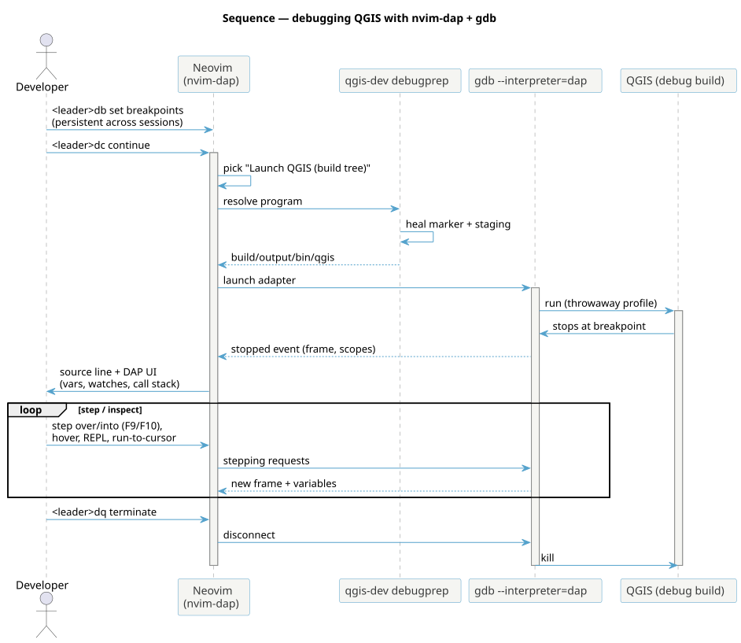

<!--
SPDX-FileCopyrightText: 2026 Kartoza (Pty) Ltd <tim@kartoza.com>
SPDX-License-Identifier: MIT
-->

# 8 · Debugging with DAP

Step through QGIS core in Neovim — breakpoints, variable inspection, the
call stack, and attach-to-running — all without leaving the editor. This
uses **nvim-dap** (shipped and configured by
[nix-vim](https://github.com/timlinux/nix-vim)) driving **gdb**'s native
DAP interpreter; the sidecar adds the C++ adapter and the QGIS launch
configurations.

{ .no-lightbox }

## Prerequisites (once)

- A **Debug build**: `qgis-dev profile debug` (the default). It compiles
  with `-g -gsplit-dwarf` and a gdb index, so the debugger has full symbols
  and starts fast. Optimised profiles (`release`) will skip and reorder
  code — debug there only when chasing an optimisation-specific bug.
- A built binary: `qgis-dev build`.

No adapter to install — nixpkgs ships **gdb 17** with `--interpreter=dap`,
and the sidecar registers it automatically when you open a `.cpp`/`.h`
buffer in the devshell.

## Start a session

1. Open the source you want to break in, e.g.
   `nvim src/core/qgsvectorlayer.cpp`.
2. Put the cursor on a line and press ++leader++ `db` to toggle a
   **breakpoint** (a red marker appears in the sign column).
3. Press ++leader++ `dc` (**continue**). With no session running, nvim-dap
   asks which configuration to launch — choose **“Launch QGIS (build
   tree)”**.
4. Behind the scenes `qgis-dev debugprep` heals the build-tree marker and
   Python staging, then hands gdb the binary. QGIS starts with a throwaway
   profile; when execution reaches your line it stops and Neovim jumps to
   it.

!!! tip "One-key equivalents"
    nix-vim maps F-keys too: ++f8++ toggle breakpoint, ++f5++ continue,
    ++f9++ step over, ++f10++ step into, ++f12++ run to cursor,
    ++shift+f5++ terminate, ++shift+f9++ toggle the DAP UI.

## Step through

| Key | Action |
|-----|--------|
| ++leader++ `dc` / ++f5++ | Continue to the next breakpoint |
| ++leader++ `dv` / ++f9++ | Step **over** the current line |
| ++leader++ `dn` / ++f10++ | Step **into** a call |
| ++leader++ `do` | Step out |
| ++leader++ `dt` / ++f12++ | Run to cursor |
| ++leader++ `dR` | Restart the session |
| ++leader++ `dq` / ++shift+f5++ | Terminate |

## Inspect state

- ++leader++ `du` (++shift+f9++) toggles the **DAP UI** — a sidebar with
  **Scopes** (locals/arguments, expandable — Qt containers like `QString`,
  `QList`, `QMap` display their contents thanks to `set print pretty on`),
  the **call stack** (click a frame to jump), **watches**, and
  **breakpoints**.
- ++leader++ `dh` shows a **hover** with the value of the symbol under the
  cursor.
- ++leader++ `dr` opens the **REPL** — type gdb/expression commands, e.g.
  `layer->name()` or `p *this`, evaluated in the current frame.
- Add a **watch** from the DAP UI’s Watches pane (or `:lua
  require('dapui').elements.watches.add('expr')`).

## Breakpoints that survive restarts

Breakpoints are **persistent across sessions** — nix-vim saves them under
`stdpath("data")/breakpoints` and reloads them when you reopen a file, so
your carefully placed traps are still there tomorrow. No action needed.
Two richer kinds:

- ++leader++ `dB` — **conditional breakpoint** (prompts for an expression;
  breaks only when true, e.g. `id == 42`).
- ++leader++ `dL` — **log point** (prints a message instead of stopping —
  `printf`-debugging without recompiling).
- ++shift+f8++ — clear **all** breakpoints.

## Attach to a running QGIS

Already have QGIS open (say it hangs, or you reached a hard-to-script UI
state)? Press ++leader++ `dc`, choose **“Attach to running QGIS”**, and
pick the process from the list (pre-filtered to `qgis`). gdb attaches to
the live process with full symbols; set breakpoints and continue.

## Debugging PyQGIS

The DAP configs above debug the **C++** side. To step through **Python**
plugin/console code, use nix-vim’s Python debugger entry (++leader++ `da`,
which attaches debugpy) against a QGIS started with the Python debugger
enabled. Mixed C++/Python stepping isn’t automatic — debug one layer at a
time.

## Troubleshooting

- **“no built binary”** — run `qgis-dev build` first.
- **No variables / `<optimized out>`** — you’re on an optimised profile;
  switch with `qgis-dev profile debug` and rebuild.
- **Adapter not offered** — you’re outside the devshell (no `gdb` on PATH)
  or not in a `cpp`/`c` buffer. `direnv allow`, reopen.
- **perf-style permission errors on attach** — see the
  [kernel setting note](../reference/qa.md#profiling).

That completes the developer journey — you can now build, run, test,
pre-commit, and step through QGIS core entirely from the editor.
