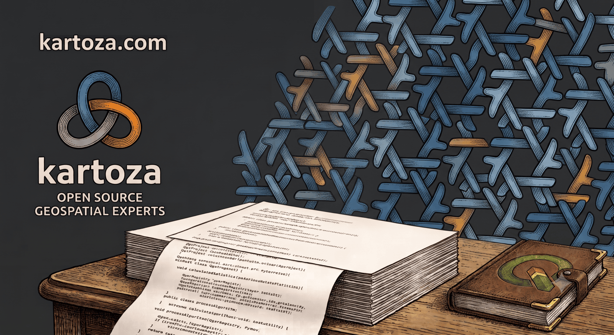

---
hide:
  - navigation
  - toc
---
<!-- SPDX-FileCopyrightText: 2026 Kartoza (Pty) Ltd <tim@kartoza.com> -->
<!-- SPDX-License-Identifier: MIT -->

KARTOZA · QGIS DEV ENV

# Hack on QGIS core, beautifully isolated

Fast incremental builds, a fully wired Neovim, and a checkout that stays
byte-pristine to upstream — reproducible on any NixOS machine.

[:material-rocket-launch: Get Started](getting-started/index.md){ .kz-cta__primary }
[:material-keyboard: Reference](reference/index.md){ .kz-cta__secondary }
[:material-shield-lock: AI Policy](about/ai-policy.md){ .kz-cta__secondary }
[:simple-github: GitHub](https://github.com/timlinux/qgis-dev-env){ .kz-cta__secondary }

{ .kz-figure .no-lightbox }

## What it is

**A complete, reproducible developer environment for
[QGIS](https://qgis.org) core — on NixOS, in Neovim.** You get ccache +
mold + Ninja incremental builds (timed and logged, all cores), a
`<leader>p` project menu for every routine task, full LSP coverage for
C++20/Qt6, Python/PyQGIS, CMake, Nix and Bash, git-worktree workflows, a
QA harness (sanitizers, valgrind, heaptrack, perf) and a fully configured
editor ([nix-vim](https://github.com/timlinux/nix-vim)) — while the QGIS
checkout itself stays **invisible to upstream git** at all times.

## Where to go

- **🚀 Start here**

    The [Developer Journey](getting-started/index.md) walks you from an
    empty folder to your first upstream patch, step by step.

- **⌨️ Live here**

    The [Reference](reference/index.md) section holds the complete
    `qgis-dev` command set, the Neovim keymap, build profiles, worktree
    and QA guides — plus the [troubleshooting field notes](reference/troubleshooting.md).

- **🔒 The golden rule**

    Nothing from this environment may ever reach upstream QGIS. Read
    [the AI policy](about/ai-policy.md) — it is why this project exists
    in its current shape.

- **📐 The blueprint**

    The full [Software Requirements Specification](about/specification.md)
    records every requirement, decision and acceptance criterion.

## Why this exists

QGIS is a ~1.5 million line C++/Qt6/Python codebase. A naive rebuild after
every change costs hours; a hand-rolled editor setup costs days and drifts
between machines. This sidecar gives every developer on the team the same
pinned toolchain (`flake.lock`), the same editor experience, and the same
guard rails — cloned in minutes, byte-identical everywhere.

And because upstream QGIS **does not accept AI-generated contributions**,
the entire environment is engineered so that none of its files can leak
into a QGIS commit: local git excludes, an anti-leak pre-push hook, and a
`doctor` that audits every worktree.

---

*Made with 💗 by [Kartoza](https://kartoza.com) ·
[Donate!](https://github.com/sponsors/timlinux) ·
[GitHub](https://github.com/timlinux/qgis-dev-env)*
