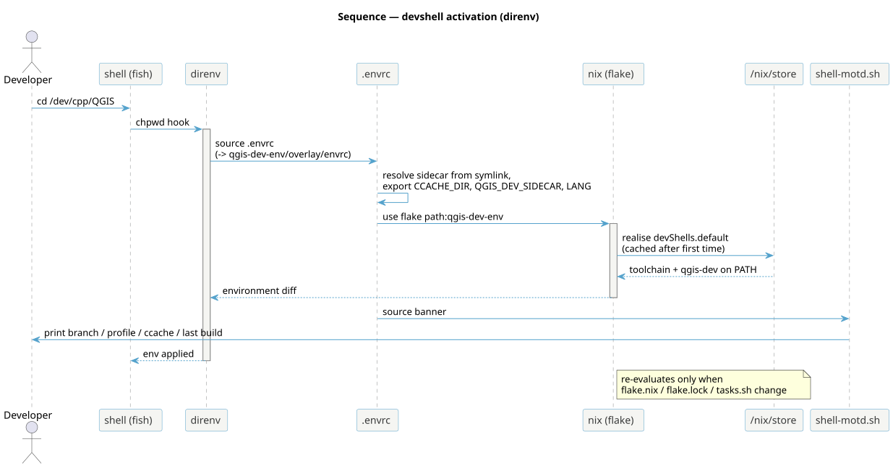

<!--
SPDX-FileCopyrightText: 2026 Kartoza (Pty) Ltd <tim@kartoza.com>
SPDX-License-Identifier: MIT
-->

# Activation & the devshell

Entering the checkout should *just work* — no manual `nix develop`, no
environment fiddling. Here is the machinery that makes that true.

{ .no-lightbox }

## The chain

1. `cd` into the checkout fires direnv's shell hook.
2. direnv sources the symlinked `.envrc` (which points into
   `qgis-dev-env/overlay/envrc`). It resolves the sidecar location from its
   own symlink target, so it works for any clone path and any worktree, and
   exports `CCACHE_DIR`, `QGIS_DEV_SIDECAR` and a UTF-8 `LANG`.
3. `use flake path:<sidecar>` realises `devShells.default`. The result is
   cached by nix-direnv, so only the **first** activation (or one after a
   watched file changes) does real work.
4. The flake's `shellHook` exports the resolved Qt plugin roots, the QML
   import path, the PyQGIS interpreter and the report-template store path —
   all computed at shell time, never committed as hard-coded store paths.
5. `.envrc` sources `lib/shell-motd.sh`, which prints the Kartoza banner
   with live data (branch, profile, ccache, last build).

## Why the banner lives in `.envrc`, not only the shellHook

nix-direnv **caches** the shellHook's output, so a banner emitted only from
the hook would appear once per flake change, not per entry. `.envrc` runs
on every activation, so the banner is sourced there (guarded by a
process-local flag so the two paths don't double-print).

## What triggers a re-evaluation

`.envrc` `watch_file`s `flake.nix`, `flake.lock` and `lib/tasks.sh`. A
change to any of those re-evaluates the devshell on your next entry
(`tasks.sh` because it is baked into the `qgis-dev` binary). Profiles,
suppressions and the banner are read live and need no reload. Because
`path:` flakes key on the sidecar's content hash, *any* sidecar commit also
prompts one quick re-evaluation — seconds when nothing material changed.
