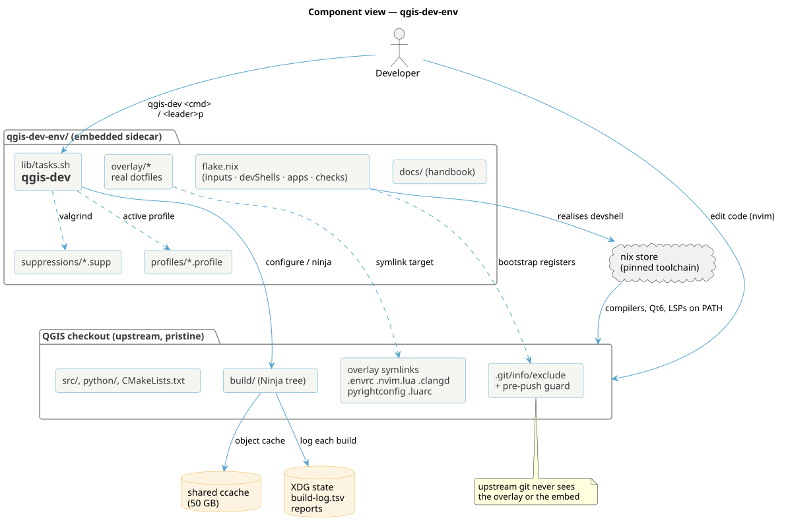
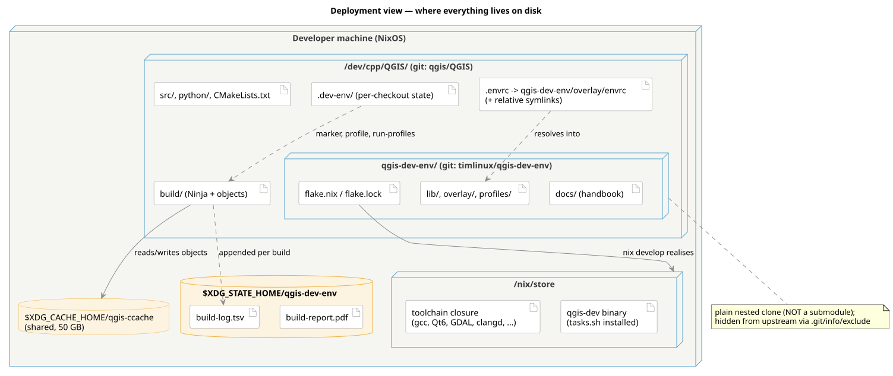

<!--
SPDX-FileCopyrightText: 2026 Kartoza (Pty) Ltd <tim@kartoza.com>
SPDX-License-Identifier: MIT
-->

# Architecture

## Component view

What the pieces are and how they talk to each other.

{ .no-lightbox }

The **QGIS checkout** stays pristine: upstream sources, a `build/` Ninja
tree, and a handful of overlay *symlinks* whose targets live in the
embedded sidecar. `.git/info/exclude` plus the pre-push guard keep all of
that invisible to upstream git.

The **sidecar** (`qgis-dev-env/`) owns everything real: the flake, the
`qgis-dev` task runner, the overlay dotfiles, build profiles, valgrind
suppressions and this handbook. The **nix store** provides the pinned
toolchain the flake realises; the **shared ccache** and **XDG state**
(build log, reports) sit outside any single checkout so they're shared
across worktrees.

## Deployment view

Where each artefact physically lives on disk.

{ .no-lightbox }

The load-bearing detail: `qgis-dev-env/` is a **plain nested git clone**,
not a submodule. A submodule would leave a committable gitlink in the QGIS
index; a nested clone has no representation in the outer repo at all except
as an untracked directory — which the managed exclude block hides. That is
the whole trick that lets an AI-assisted toolkit live *inside* a checkout
whose upstream forbids AI contributions.
