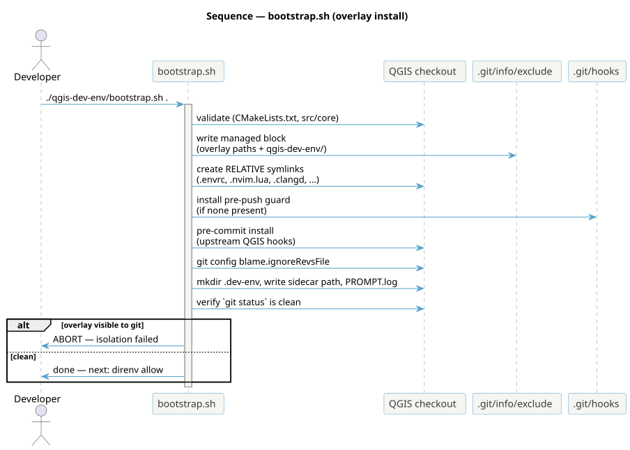
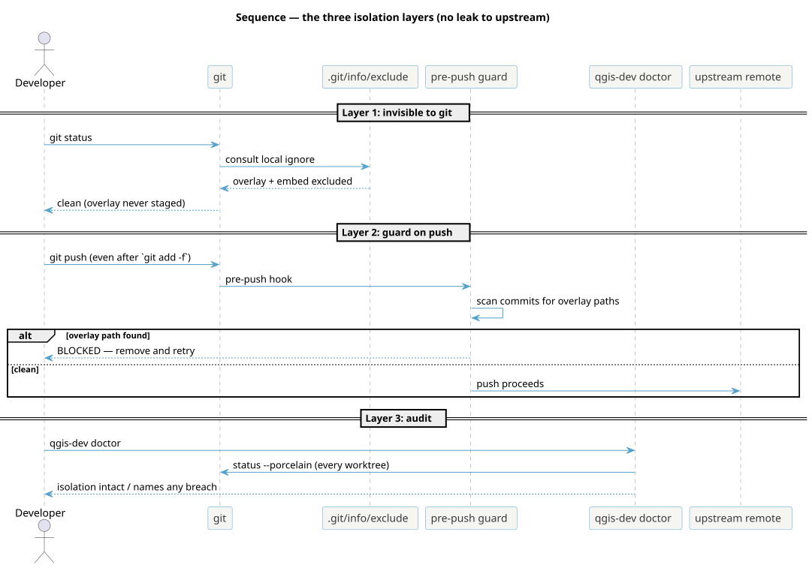

<!--
SPDX-FileCopyrightText: 2026 Kartoza (Pty) Ltd <tim@kartoza.com>
SPDX-License-Identifier: MIT
-->

# Bootstrap & isolation

## What bootstrap does

`bootstrap.sh <checkout>` is idempotent and touches **no tracked upstream
file**. Every action is one of: create a relative symlink, maintain the
managed exclude block, install a hook, or write local state.

{ .no-lightbox }

The managed exclude block is delimited by marker comments in
`.git/info/exclude`, so re-running bootstrap rewrites exactly that block
and never duplicates entries. `--remove` strips the block, unlinks the
overlay, and preserves your `PROMPT.log` and state under
`$XDG_STATE_HOME`. When the sidecar is embedded in the checkout, symlinks
are **relative** (so the whole tree is movable); when external, absolute.

## The three isolation layers

Upstream QGIS does not accept AI contributions, and this tooling must never
reach it. Three independent layers enforce that, plus one human.

{ .no-lightbox }

1. **Invisible to git.** The overlay files *and the embedded
   `qgis-dev-env/`* are listed in `.git/info/exclude` — git's local-only
   ignore, never committed, shared by all worktrees. `git status` is clean.
2. **Guarded on push.** A `pre-push` hook scans outgoing commits for
   overlay paths and blocks the push if any appear — defeating even a
   `git add -f` slip. It lives in the common git dir, so it covers every
   worktree.
3. **Audited on demand.** `qgis-dev doctor` runs `git status --porcelain`
   across every registered worktree and names any breach.

The human layer: tooling keeps *files* apart, but only you keep
*authorship* apart. Editor conveniences (completion, formatting) are
ordinary developer tooling; generating QGIS code with an AI and submitting
it is what the upstream policy forbids. See the
[AI policy](../about/ai-policy.md).

!!! warning "The one way to break it"
    `git clean -fdx` deletes *ignored* files — which now includes the embed
    and `build/`. Plain `git clean -fd` is safe.
