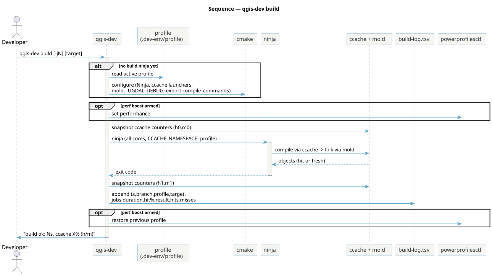
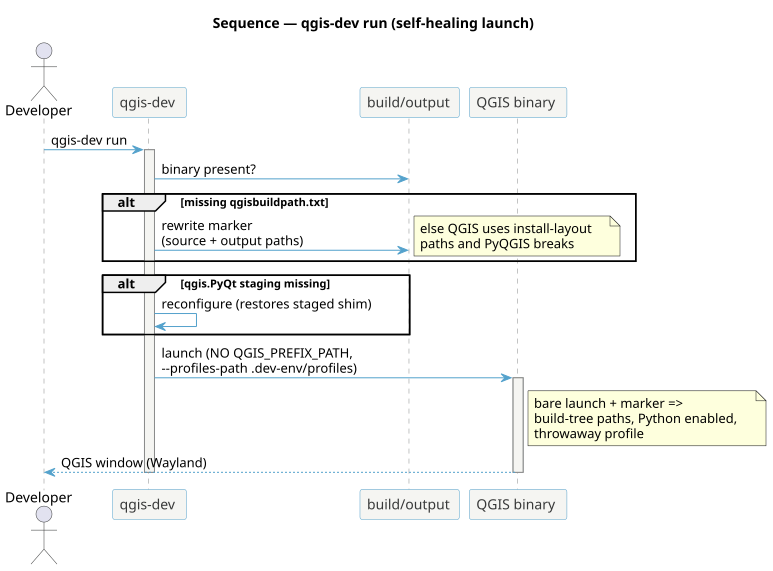
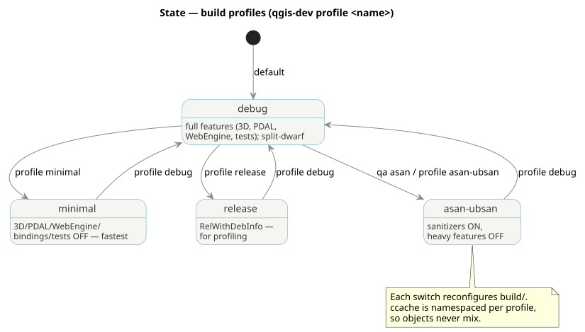

<!--
SPDX-FileCopyrightText: 2026 Kartoza (Pty) Ltd <tim@kartoza.com>
SPDX-License-Identifier: MIT
-->

# Build, run & profiles

## Build

`qgis-dev build` is an ordinary CMake/Ninja build **in the working tree** —
nix provisions the toolchain, never a store build of QGIS (constraint C10),
because a store build would forfeit incrementality.

{ .no-lightbox }

Key mechanics visible above: configure happens automatically on first build
with the active profile's flags (ccache launchers, mold-wrapped linker,
`-UGDAL_DEBUG`, `compile_commands.json` export); ccache counters are
snapshotted before and after so the logged hit-rate is *per build*; the
optional performance-mode boost wraps the ninja run and is always restored;
and every build appends a row to the machine-global log that `stats` and
`report` read.

## Run

`qgis-dev run` launches the build-tree binary — and self-heals the two
configure-time artefacts that, if missing, silently break it.

{ .no-lightbox }

- **`qgisbuildpath.txt`** tells QGIS it is running from a build tree, so
  resources and PyQGIS resolve against `build/output` rather than an
  uninstalled prefix. It's written at configure time only, so `run`
  rewrites it if absent.
- **The `qgis.PyQt` shim** is `configure_file`-staged; if it went missing,
  `run` reconfigures to restore it.
- The launch is **bare** — no `QGIS_PREFIX_PATH` (which would force
  install-layout paths) — with a throwaway `--profiles-path` so your real
  QGIS profile is untouchable.

## Profiles

A profile is a committed `CMAKE_ARGS` fragment. Switching reconfigures the
tree; ccache is namespaced per profile so objects never mix.

{ .no-lightbox }

See [Build profiles & flags](../reference/profiles.md) for the everyday
usage, and [Troubleshooting](../reference/troubleshooting.md) for the
field-tested reasons behind `-UGDAL_DEBUG`, `mold-wrapped` and the
self-healing markers.
