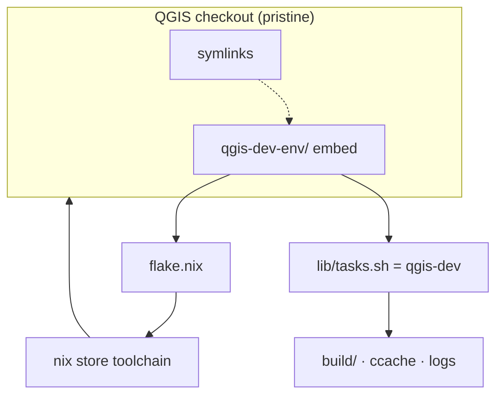

<!--
SPDX-FileCopyrightText: 2026 Kartoza (Pty) Ltd <tim@kartoza.com>
SPDX-License-Identifier: MIT
-->

# Under the Hood

How every part of `qgis-dev-env` actually works — for when you want to
extend it, debug it, or port the idea elsewhere. The UML diagrams here are
rendered from PlantUML sources in `docs/uml/*.puml` via `nix run
.#diagrams`, so they stay honest as the code changes.

- [Architecture](architecture.md) — the component and deployment views
- [The flake](the-flake.md) — inputs, devShells, apps, checks
- [The task runner](task-runner.md) — one `qgis-dev`, three front-ends
- [Bootstrap & isolation](bootstrap-isolation.md) — symlinks, excludes, the guard
- [Activation & the devshell](activation.md) — direnv → nix → banner
- [Build, run & profiles](build-run.md) — the edit-compile-run machinery

## The 30-second mental model

Three ideas do all the work:

1. **Composition, not forking.** The devshell is built *on top of* upstream
   QGIS's own package definition, so every library QGIS needs is present
   without us maintaining a copy.
2. **One implementation, many doors.** `lib/tasks.sh` (the `qgis-dev`
   command) is the single source of behaviour; Neovim, `nix run` and the
   terminal are thin callers.
3. **Isolation by git's own mechanisms.** Local excludes + a pre-push hook
   + a doctor keep the tooling invisible to upstream — no patched files, no
   submodule, nothing to leak.
