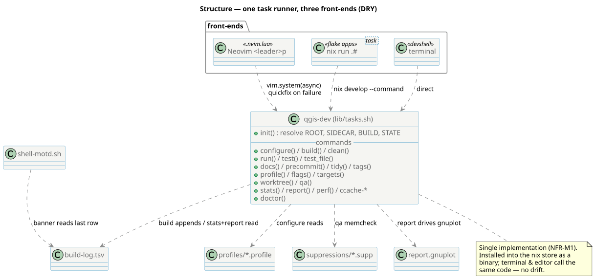

<!--
SPDX-FileCopyrightText: 2026 Kartoza (Pty) Ltd <tim@kartoza.com>
SPDX-License-Identifier: MIT
-->

# The task runner

`lib/tasks.sh` *is* the `qgis-dev` command. It is the single source of
behaviour behind three front-ends, so nothing can drift between how the
editor, a terminal, and CI build QGIS.

{ .no-lightbox }

## One implementation, three doors

- **Neovim** (`overlay/nvim.lua`) maps `<leader>p…` to `vim.system` calls
  that run `qgis-dev <cmd>` asynchronously and parse failures into the
  quickfix list.
- **`nix run .#<cmd>`** enters the devshell and calls the same binary.
- **The terminal** calls `qgis-dev` directly inside the devshell.

The flake installs `tasks.sh` into the nix store as `qgis-dev`
(`install -Dm755`), so the front-ends all execute identical bytes.

## Anatomy of a call

`init()` resolves four locations from the current directory: `ROOT` (the
checkout, via `git rev-parse`), `SIDECAR` (from `.dev-env/sidecar` or the
`.envrc` symlink target), `BUILD` (`ROOT/build`) and `STATE`
(`ROOT/.dev-env`). Read-only commands that don't need a checkout — `stats`,
`report`, `perf` — deliberately skip `init` (it `die`s outside a checkout,
and `die` calls `exit`, which `|| true` cannot catch).

Commands then compose smaller helpers: `cmd_build` snapshots ccache
counters around `ninja` and appends a row to the log; `cmd_configure`
sources the active `profiles/*.profile` fragment onto a `CMAKE_ARGS` array;
`cmd_report` runs an `awk` pass to produce clean data + summary scalars and
drives `report.gnuplot`.

## Where behaviour lives

| Concern | File (read at runtime from `SIDECAR`) |
|---|---|
| Build presets | `profiles/{debug,minimal,release,asan-ubsan}.profile` |
| Valgrind noise filters | `suppressions/{qt6,glib,python}.supp` |
| Infographic template | `lib/report.gnuplot` (also exported as a store path) |
| Activation banner | `lib/shell-motd.sh` |

Because these are read live from the sidecar, editing a profile or the
banner takes effect immediately — no devshell rebuild. Editing `tasks.sh`
*does* need a reload, since it is baked into the `qgis-dev` binary; the
`.envrc` therefore watches it.
