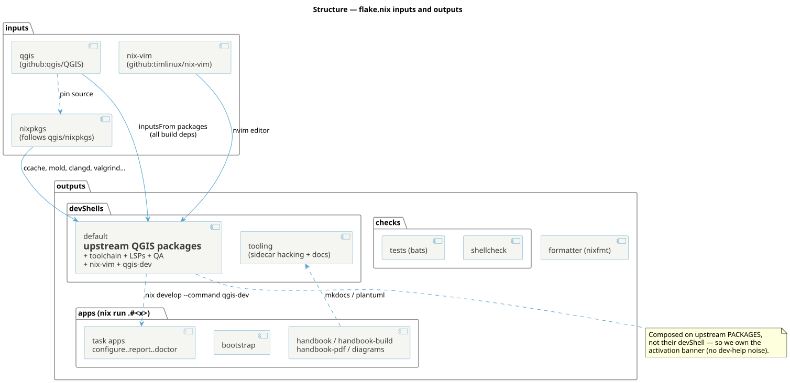

<!--
SPDX-FileCopyrightText: 2026 Kartoza (Pty) Ltd <tim@kartoza.com>
SPDX-License-Identifier: MIT
-->

# The flake

`flake.nix` is the spine. It pins the world, composes the devshell, and
exposes every task as a runnable app.

{ .no-lightbox }

## Inputs

| Input | Role |
|---|---|
| `qgis` (`github:qgis/QGIS`) | Upstream's own flake — we consume its **packages**, which carry the complete QGIS dependency set |
| `nixpkgs` | `follows` the QGIS input's nixpkgs, so our extra tools match upstream's library versions |
| `nix-vim` (`github:timlinux/nix-vim`) | The standard team editor, pinned independently so it behaves as released |
| `clang-tools-pin` (nixpkgs-unstable) | clang-format / clang-tidy at the QGIS-pinned major (v21); the toolchain nixpkgs only carries LLVM 19, and formatting must match CI (FR-Q4) |

Because inputs are content-addressed and locked in `flake.lock`, every
colleague resolves the identical toolchain. Entering the directory fetches
the pinned QGIS *source snapshot* once (nix needs it to evaluate the
devshell) — that is the ~240 MiB copy you see on first activation, not a
QGIS build.

## devShells

`devShells.default` is composed with `inputsFrom = [ qgis.packages…qgis
qgis…unwrapped ]` — i.e. **upstream's packages, not their devShell**. That
distinction matters: pulling their `devShell` would inherit their
`dev-help` banner and shell hook; pulling their *packages* gives us the
exact same dependency closure while we own the activation experience (our
Kartoza banner). On top we add ccache, mold-wrapped, clangd, the LSP
servers, the QA tools, `nix-vim` and the `qgis-dev` binary.

`devShells.tooling` is the lighter shell for hacking on the sidecar itself:
mkdocs, plantuml, shellcheck, bats, gitleaks, reuse, nixfmt, stylua.

## apps

Every task is also `nix run .#<task>` (`configure`, `build`, `run`,
`test`, `report`, `doctor`, …) — each is a one-liner that enters the
devshell and calls `qgis-dev`. Plus `bootstrap`, the docs apps
(`handbook`, `handbook-build`, `handbook-pdf`) and `diagrams`. This is what
gives terminal / editor / CI the same capabilities (FR-N4).

## checks & formatter

`nix flake check` builds `checks.tests` (the bats suite, shebang-patched
for the sandbox) and `checks.shellcheck`. `formatter` is nixfmt. CI runs
exactly these.

!!! note "No code embedded in Nix"
    Per the project's rules, the flake never inlines shell or lua. It
    references real dotfiles — `lib/tasks.sh`, `lib/shell-motd.sh`,
    `lib/report.gnuplot`, `overlay/*` — and, where a runtime store path is
    needed (the report template), exports it as an env var.
