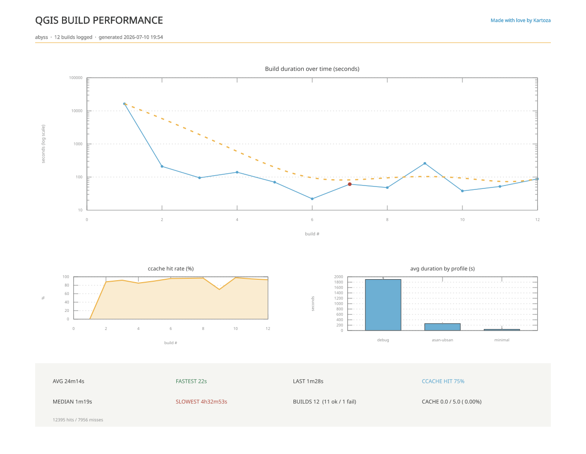

<!--
SPDX-FileCopyrightText: 2026 Kartoza (Pty) Ltd <tim@kartoza.com>
SPDX-License-Identifier: MIT
-->

# Build profiles & flags

A profile is a committed set of CMake arguments (`profiles/*.profile`).
Switch with `qgis-dev profile <name>` or `<leader>px`; the active profile
is stored per-worktree in `.dev-env/profile` and reconfigures on switch.

| Profile | Build type | Feature set | Use for |
|---|---|---|---|
| `debug` *(default)* | Debug | Everything on (3D, PDAL, WebEngine, tests) | Everyday development and debugging |
| `minimal` | Debug | 3D/PDAL/WebEngine/tests/**bindings** off | Fastest core-C++ iteration (not PyQGIS work) |
| `release` | RelWithDebInfo | Everything on | Profiling and performance work — Debug timings mislead |
| `asan-ubsan` | Debug + sanitizers | 3D/PDAL/WebEngine off | Memory and UB bug hunts (`qgis-dev qa asan`) |

All profiles share: Ninja, ccache compiler launchers, the (wrapped) mold
linker, `compile_commands.json` export, and (Debug) split dwarf +
gdb-index for fast links and fast debugger startup. Debug-config profiles
also pass `-UGDAL_DEBUG` (see
[Troubleshooting](troubleshooting.md) for why). ccache objects are
**namespaced per profile**, so switching never poisons the cache.

## Tweaking individual flags

Interactive: `<leader>pk` lists the current `WITH_*` / `ENABLE_*` /
`BUILD_*` cache values — booleans toggle in one keypress, strings prompt
for a value, and the tree reconfigures.

Terminal:

```bash
qgis-dev flags                          # see current values
qgis-dev configure -DWITH_3D=OFF        # persist any override
```

Overrides live in `build/CMakeCache.txt` and survive rebuilds; switching
profile resets to that profile's declared set.

## Where the time goes

Every build appends to `~/.local/state/qgis-dev-env/build-log.tsv`:

```text
timestamp  host  worktree  branch  profile  targets  jobs  duration_s
ccache_hit_pct  result  ccache_hits  ccache_misses
```

The hit rate and the raw hit/miss counts are **per build** (counter deltas
around each ninja run), not lifetime averages — so builds of different
sizes compare honestly.

## Analysing your build history

Three views, increasing in polish, all reading the same log:

| Command | Output |
|---|---|
| `qgis-dev stats [N]` (`<leader>pG`) | Terminal table of the last N builds + a unicode sparkline + avg/min/max — the quick glance |
| `qgis-dev stats --graph` | `build-times.svg`, a single duration line chart |
| `qgis-dev report [--pdf\|--svg\|--png] [--open]` (`<leader>pR`) | A **branded multi-panel infographic** (below) |

{ .no-lightbox }

`qgis-dev report` renders a Kartoza-styled dashboard to
`$XDG_STATE_HOME/qgis-dev-env/build-report.<ext>` (PDF by default;
`--open` launches your viewer). It has four zones:

- **Duration over time** — every build as a line + point; failed builds
  marked in red; an amber bezier trend line. The y-axis auto-switches to
  **log scale** when a cold build would otherwise flatten the
  incrementals, so seconds-scale rebuilds stay legible next to a
  multi-hour first build.
- **ccache hit rate** — the percentage per build, filled area.
- **Average duration by profile** — bars for debug / minimal / release /
  asan-ubsan, annotated with build counts, so you can see what each
  profile actually costs you.
- **Summary band** — average, median, fastest, slowest and last build
  times; total builds with ok/fail split; overall ccache hit rate, cache
  size, and cumulative hits/misses.

The same command is `nix run .#report` from any terminal. Because the log
is machine-global (`$XDG_STATE_HOME/qgis-dev-env/build-log.tsv`), the
report spans every checkout and worktree on the machine — compare
profiles, branches and hardware with real numbers instead of vibes.

!!! tip "Roll your own"
    The log is plain TSV with a header row (see the schema above) — load
    it into `datamash`, a notebook, or a spreadsheet for any analysis the
    built-in report doesn't cover.
