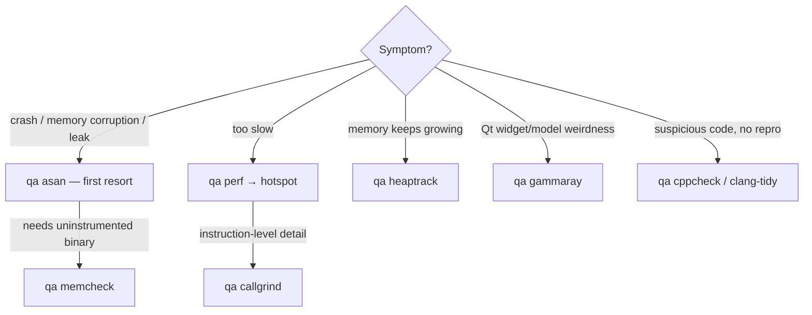

<!--
SPDX-FileCopyrightText: 2026 Kartoza (Pty) Ltd <tim@kartoza.com>
SPDX-License-Identifier: MIT
-->

# QA & diagnostics

One keystroke from "it crashes / leaks / is slow" to actionable,
source-line evidence. All reports are archived under
`.dev-env/diagnostics/<timestamp>-<tool>/` (`<leader>pal` to browse) —
exactly what an upstream bug report wants attached.

## Choosing the right tool

## Sanitizers first (`qgis-dev qa asan`, `<leader>pas`)

Switches to the `asan-ubsan` profile, rebuilds (own ccache namespace),
runs QGIS with AddressSanitizer + UBSan, and prints the reports. At ~2×
slowdown this is the default memory-bug tool; valgrind's 20–50× makes
whole-app runs impractical. Switch back with `qgis-dev profile debug`.

## Valgrind when it must be (`qa memcheck`, `<leader>pam`)

For uninstrumented binaries and the tools only valgrind has. Committed
suppression files for **Qt6, glib and CPython's pymalloc** are applied
automatically — without them, PyQGIS drowns real leaks in interpreter
false positives. Findings are resolved to `file:line` and land in
quickfix; the full log stays in the archive.

## Profiling

- **CPU** — `qa perf` records with dwarf call graphs and opens
  [hotspot](https://github.com/KDAB/hotspot). Requires
  `boot.kernel.sysctl."kernel.perf_event_paranoid" = 1;` (or lower) in
  your NixOS config. `qa callgrind` + kcachegrind for per-instruction
  detail.
- **Heap** — `qa heaptrack` (better fit for Qt apps than massif); the GUI
  opens when QGIS exits.
- Profile against the `release` profile — Debug timings mislead.

## Live Qt introspection (`qa gammaray`, `<leader>pag`)

Attaches GammaRay to the running QGIS for live widget-tree, model and
signal/slot inspection. Start QGIS first (`<leader>pr`).

## Static analysis

`qa cppcheck [path]` sweeps beyond what clang-tidy covers; `<leader>pl`
runs clang-tidy (upstream `.clang-tidy`) on the current file. Both report
to quickfix.
